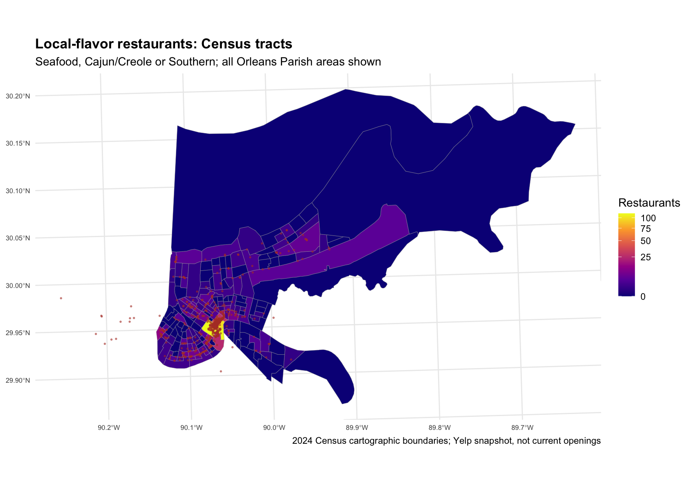

# Yelp New Orleans Restaurant Analysis

This repository contains the data-import and filtering work for Homework 5 and the Yelp New Orleans Restaurant Analysis project.

## Homework 6 — geographic analysis (Steps 1–6)

**[Read the complete Homework 6 analysis, tables and maps](reports/homework6.md)**

I am selecting **2024 Census tracts within Orleans Parish, New Orleans**, after comparing Census tracts with Census block groups. The theme is Seafood, Cajun/Creole and Southern restaurants (at least one exact category label).

- The category union contains **648 restaurants and 248,426 reviews**.
- **632 restaurants span 108 tracts**, exceeding the requirement of 10 restaurants in 7 areas; 16 restaurants remain unmatched to Orleans Parish polygons and are documented.
- Of the occupied areas, **79/108 tracts (73.1%)** versus **137/160 block groups (85.6%)** contain fewer than five restaurants. Tracts reduce fragmentation, though sparse areas still require caution. Geography was not selected to maximize ratings.



The report includes both geographic maps, a comparison table, category co-occurrence, a city-boundary mismatch audit, rating summaries and the reason for choosing tracts. It is viewable directly on GitHub. See [analysis code](R/homework6.R), [complete comparison table](tables/geographic_comparison.csv), and [AI use](AI_USAGE.md).

To reproduce, install `tidyverse` and `sf` and run `Rscript R/homework6.R` from the repository root. Census source ZIPs are included; the raw Yelp JSON files are not needed to repeat Homework 6 because the filtered RDS inputs are committed. Step 7 reviewer normalization is future work.

## Homework 5 completed steps

1. Created a new GitHub repository/project directory.
2. Downloaded and extracted the Yelp Open Dataset.
3. Imported the large business and review JSON files into R.
4. Filtered the business data to New Orleans restaurants.
5. Filtered the review data to reviews associated with those restaurants.
6. Saved the filtered data as compressed RDS files.

## Data

The original Yelp JSON files are not committed because they are several gigabytes in size. Download the JSON archive from the [Yelp Open Dataset](https://business.yelp.com/data/resources/open-dataset/) page and extract these files into `data/raw/`:

- `yelp_academic_dataset_business.json`
- `yelp_academic_dataset_review.json`

Filtered outputs are saved in `data/new_orleans/`.

## Reproduce the data preparation

From the project root, run:

```r
source("R/import_filter.R")
```

The review file is processed in chunks to reduce memory use. The import may take several minutes.

## Files

- `R/import_filter.R`: imports, filters, validates, and saves the data.
- `data/new_orleans/business_new_orleans.rds`: New Orleans restaurant businesses.
- `data/new_orleans/reviews_new_orleans.rds`: reviews for the retained restaurants.
- `data/new_orleans/import_summary.txt`: row counts and basic validation results.

