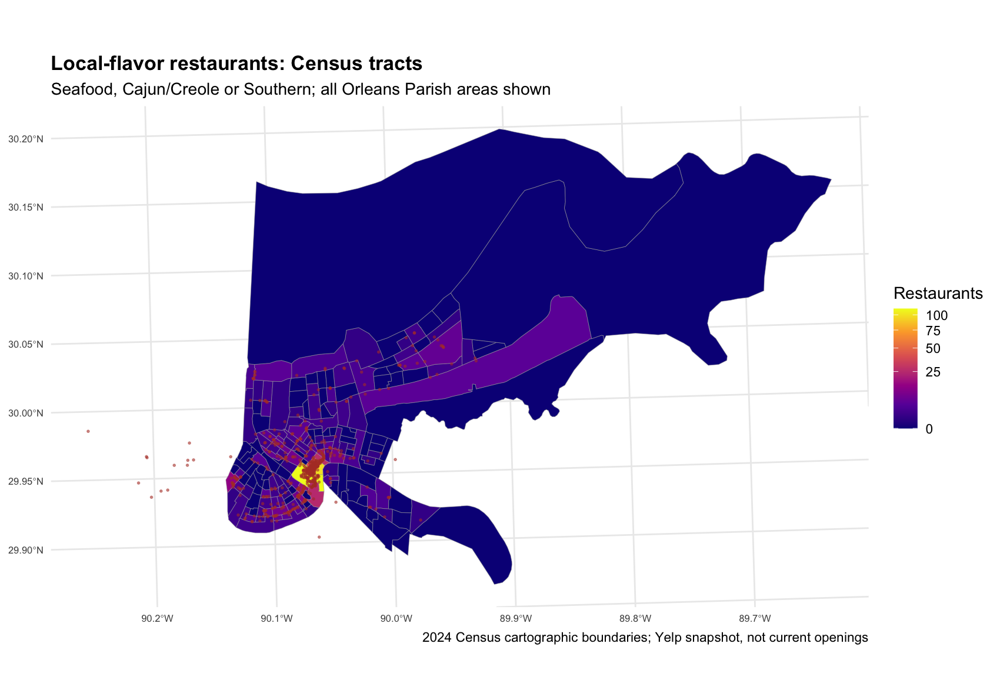
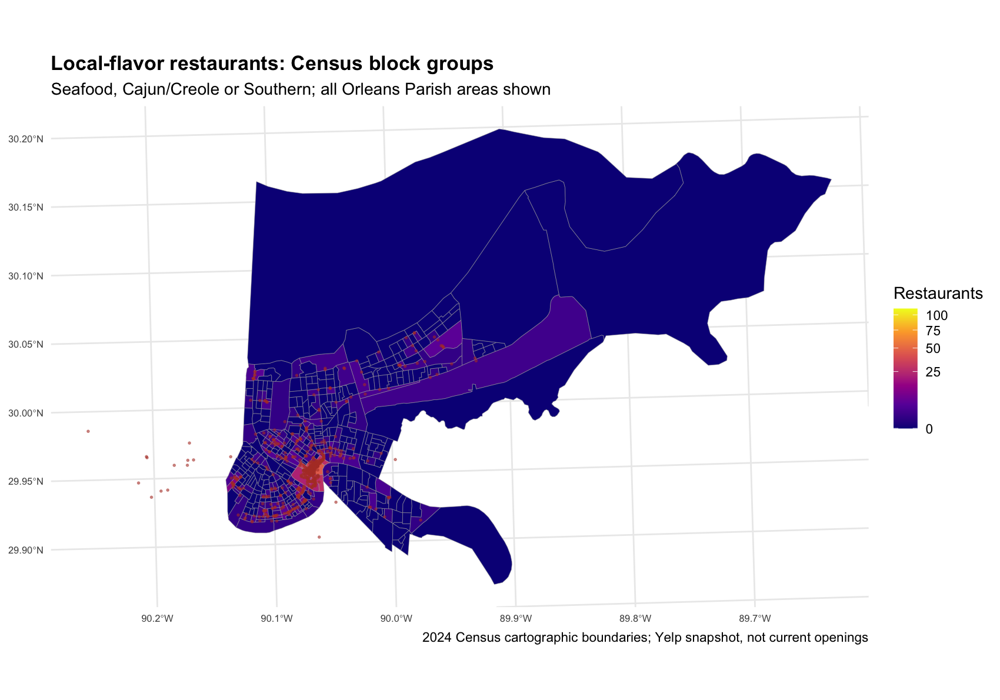
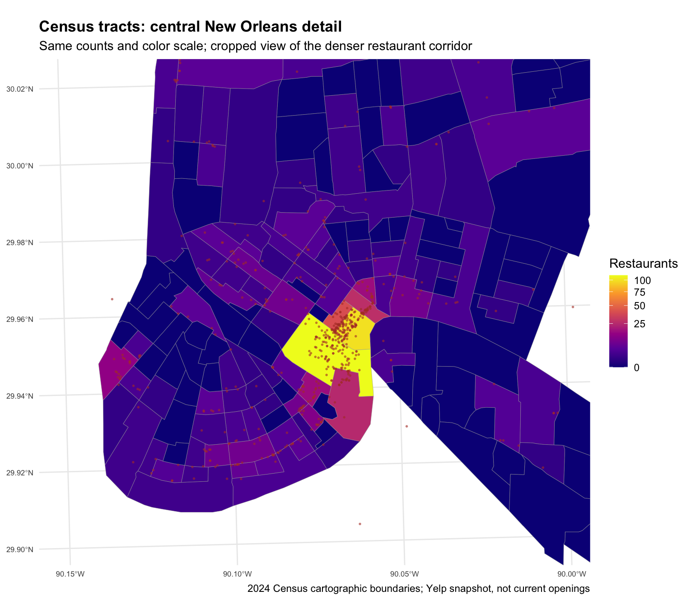
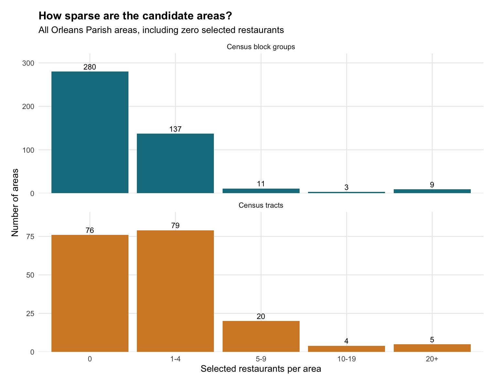
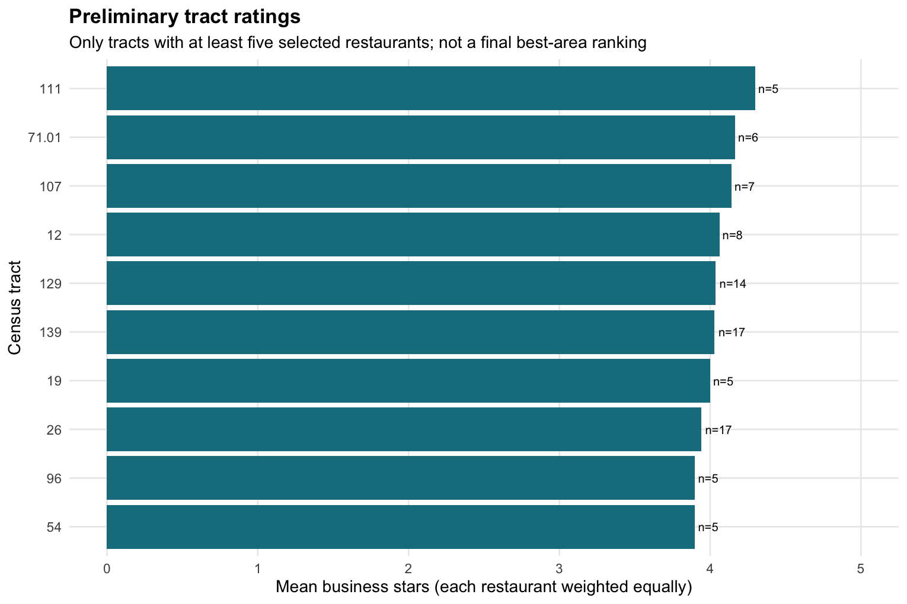

# Homework 6: Choosing a geographic area

## Decision and research question

**Chosen region: New Orleans, Louisiana. Chosen geographic unit: 2024 Census tracts within Orleans Parish (FIPS 22071).**

Research question: Where can someone find the best Seafood, Cajun/Creole, or Southern restaurants in New Orleans, and which geographic area is most useful for comparing them?

I choose Census tracts for the main analysis. The selected group includes **648 restaurants and 248426 available reviews**. Tracts assign 632 restaurants across 108 occupied areas, compared with 160 occupied block groups. The median occupied tract contains 2 restaurants; the median occupied block group contains 2. Tracts provide a less fragmented comparison while retaining local detail. This decision is based on sample support and spatial resolution, not the highest ratings.

## Steps 1–2: Data and large-file management

Homework 5 imported the complete Yelp business JSON and streamed all 6,990,280 review records in 50,000-record chunks, keeping reviews linked to 2,259 New Orleans restaurant businesses. The resulting RDS files contain 2,259 businesses and 476,421 reviews. Raw JSON files were extracted locally and excluded from GitHub. Chunking avoids holding the entire review database in memory; compressed RDS files reduce storage. No development sample substitutes for the complete New Orleans data. The code and import summary are linked below.

The initial definition is `state == 'LA'`, `city == 'New Orleans'`, and a nonmissing categories field containing Restaurants. Duplicate business IDs are removed. Missing postal codes are stored as NA, whitespace is cleaned, and coordinates are checked (no missing coordinates in the retained data). Closed businesses are retained to match the historical review database; this is not a current restaurant directory.

## Step 3: A coherent local-flavor category group

Seafood, Cajun/Creole and Southern form a New Orleans regional-food theme: seafood is an ingredient focus, Cajun/Creole is a regional cooking tradition, and Southern broadens the regional menu context. They were chosen for that connection, not simply because they are the most frequent labels. Categories are split at commas, trimmed, lowercased and deduplicated per business. Include a restaurant if it has **at least one exact label** in this group.

| category | n |
| --- | --- |
| cajun/creole | 401 |
| seafood | 331 |
| southern | 155 |

Counts overlap; they should not be added to obtain the unique restaurant count.

### Category co-occurrence

| category.x | category.y | n |
| --- | --- | --- |
| cajun/creole | seafood | 156 |
| cajun/creole | southern | 72 |
| seafood | southern | 45 |

Each pair counts distinct businesses with both labels. Overlap supports a shared regional-food theme, while the OR rule also keeps restaurants specializing in only one of these cuisines. This creates broad coverage without requiring every restaurant to fit all three labels. Full category counts and pair counts are saved as CSV files. Exact-label matching is important: a broad Seafood substring search also captures other labels, whereas the actual Seafood category has 331 restaurants.

The union contains **648 distinct restaurants**. Under the chosen tract system, **632 restaurants occupy 108 different tracts**, exceeding the required 10 restaurants and 7 areas. Unmatched restaurants remain explicitly recorded.

## Step 4: Join businesses and reviews

The full New Orleans review RDS is filtered with a semi-join to the selected business IDs before computing review summaries. The group retains **248426 reviews for 648 businesses**. Review-level stars are summarized per business, then left-joined to business records by business_id, giving one row per restaurant. Geographic review-weighted stars weight these business review means by their actual available review counts. Business-star averages weight each restaurant equally. These measures answer different questions and are not interchangeable.

## Step 5: Official city boundary check

Longitude/latitude are first interpreted as WGS84 (EPSG:4326). Points and polygons are transformed to EPSG:26915 before `sf::st_join(..., join = st_within)`. The initial Yelp city label is compared with all Louisiana place polygons from the 2024 Census cartographic boundary release.

| city | place_name | restaurants |
| --- | --- | --- |
| New Orleans | New Orleans | 2202 |
| New Orleans | Elmwood | 18 |
| New Orleans | Jefferson | 13 |
| New Orleans | Harahan | 10 |
| New Orleans | Terrytown | 4 |
| New Orleans | Metairie | 3 |
| New Orleans | River Ridge | 3 |
| New Orleans | Arabi | 2 |
| New Orleans | Harvey | 2 |
| New Orleans | Gretna | 1 |
| New Orleans | Kenner | 1 |

**57 restaurant coordinates do not match the New Orleans place polygon.** Individual names, coordinates, matched place labels and distances to the New Orleans polygon are recorded in [the mismatch audit](../tables/place_mismatches.csv). A city-text label is not proof of municipal membership. Possible causes are postal-city labeling, geocoding errors, changed locations, or simplified river/coast boundaries; the available data cannot resolve those causes. I retain the original city-label universe and flag these records rather than silently deleting or moving them. The tract/block-group comparison uses Orleans Parish polygons; points outside them remain unmatched, so the comparisons below use explicitly assigned restaurants.

The mismatches include 18 restaurants in Elmwood, 13 in Jefferson and 10 in Harahan (41 of the 57). These are named outside places, so this pattern is consistent with postal-city labels or geocoding/location issues, rather than only tiny river-edge errors. The audit gives distances so the cases can be investigated individually; it does not establish which explanation is correct.

## Step 6: Compare and defend geographic systems

Both candidate systems use all 2024 Orleans Parish areas and the identical selected restaurant points. Every polygon is counted, including areas with zero selected restaurants. Occupied areas have at least one. The smallest occupied count excludes zeros; zero areas are reported separately. A restaurant exactly on a shared boundary may remain unmatched under st_within; no nearest-area imputation is used.

| System | Areas | Occupied | Assigned | Unmatched |
| --- | --- | --- | --- | --- |
| Census tracts | 184 | 108 | 632 | 16 |
| Census block groups | 440 | 160 | 632 | 16 |

| System | Zero | Min_occupied | Max | Under_5 | Median_occupied |
| --- | --- | --- | --- | --- | --- |
| Census tracts | 76 | 1 | 111 | 79 | 2 |
| Census block groups | 280 | 1 | 54 | 137 | 2 |

Maps use the same full-city view, with red points representing selected restaurants. Large low-density areas and the river help explain uneven coverage; the boundaries represent statistical areas, not restaurant-defined districts.

### Why Census tracts?

Block groups provide more local detail, but 137 of 160 occupied block groups have fewer than five selected restaurants. Tracts have 79 of 108 occupied areas below that threshold. Tracts therefore reduce fragmentation, although sparse tracts still exist. The five-restaurant threshold is an exploratory stability screen, not a statistical guarantee; complete unfiltered area summaries remain available in the CSV files.

Tracts support comparisons within a city and have stable geographic identifiers that can be documented and mapped. Their weakness for visitors is unfamiliar numeric labels: they are Census statistical areas, not named neighborhoods. The final report should pair tract GEOIDs with maps and restaurant addresses. Block groups may be useful for later street-scale exploration, but they split the evidence into smaller samples. Neither system describes walkability or equal-sized commercial districts.

### Block-group rating evidence

For comparison, here are the five block groups with the largest selected-restaurant counts, with their business-star averages and review volume. Full summaries for all block groups and tracts, including zero-count areas and unmatched restaurant assignments, are linked below.

| area_id | area_name | restaurants | mean_business_stars | median_business_stars | review_weighted_stars | available_reviews |
| --- | --- | --- | --- | --- | --- | --- |
| 220710135021 | 1 | 54 | 3.70 | 4.0 | 3.87 | 52551 |
| 220710135022 | 2 | 45 | 3.52 | 3.5 | 3.83 | 17890 |
| 220710134003 | 3 | 34 | 3.78 | 4.0 | 3.91 | 24467 |
| 220710135011 | 1 | 34 | 3.75 | 3.5 | 3.94 | 17248 |
| 220710134004 | 4 | 28 | 3.52 | 3.5 | 3.61 | 16677 |

### Preliminary tract evidence

The following ten tracts have the highest mean business ratings among those containing at least five selected restaurants. They are exploratory area summaries, **not the final Top 10 restaurants**. More reviews do not necessarily imply a more representative sample.

| area_id | area_name | restaurants | mean_business_stars | median_business_stars | review_weighted_stars | available_reviews |
| --- | --- | --- | --- | --- | --- | --- |
| 22071011100 | 111 | 5 | 4.30 | 4.00 | 4.14 | 1047 |
| 22071007101 | 71.01 | 6 | 4.17 | 4.25 | 4.24 | 270 |
| 22071010700 | 107 | 7 | 4.14 | 4.00 | 4.13 | 796 |
| 22071001200 | 12 | 8 | 4.06 | 4.00 | 4.03 | 2717 |
| 22071012900 | 129 | 14 | 4.04 | 4.50 | 4.30 | 4494 |
| 22071013900 | 139 | 17 | 4.03 | 4.00 | 3.85 | 4605 |
| 22071001900 | 19 | 5 | 4.00 | 4.00 | 3.93 | 1365 |
| 22071002600 | 26 | 17 | 3.94 | 4.00 | 3.89 | 4638 |
| 22071005400 | 54 | 5 | 3.90 | 4.00 | 3.99 | 1098 |
| 22071009600 | 96 | 5 | 3.90 | 4.00 | 4.11 | 4520 |

## Limitations and next step

The Yelp snapshot predates these 2024 boundaries; historical openings, closures and coordinates can disagree with later boundaries. Cartographic boundaries at 1:500,000 simplify geometry, particularly near water. An exact TIGER/Line boundary check would improve borderline assignments. Yelp users and businesses are not a random sample; regional categories are imperfect and can overlap. Small area means can be unstable, and the choice of geographic scale can change the apparent pattern. Ratings alone do not establish a causal effect of location.

Reviewer-normalized scores and reviewer-activity sensitivity checks belong to Step 7 and are not yet calculated. This Homework 6 decision uses coverage, counts, business ratings and available review volume. The next stage will test whether restaurant/area conclusions change after reviewer normalization, then develop the final restaurant recommendations.

## Reproduce and inspect

Install `tidyverse` and `sf`, then from the repository root run `Rscript R/homework6.R`. The two Homework 5 RDS files are inputs. Census ZIP archives are included for reproducibility; the script downloads them from the official URLs if absent. Rendering is unnecessary: this Markdown report, embedded PNG figures and CSV tables are viewable directly on GitHub.

- [Homework 5 import source](../R/import_filter.R)
- [Homework 6 analysis source](../R/homework6.R)
- [Geographic comparison CSV](../tables/geographic_comparison.csv)
- [Complete tract summaries](../tables/tracts_summary.csv)
- [Complete block group summaries](../tables/block_groups_summary.csv)
- [Restaurant tract assignments](../tables/tracts_assignments.csv)
- [Category counts](../tables/category_counts.csv)
- [Category co-occurrence counts](../tables/category_pairs.csv)

## Sources

- [Yelp Open Dataset](https://business.yelp.com/data/resources/open-dataset/)
- [Census 2024 cartographic boundary files](https://www.census.gov/geographies/mapping-files/2024/geo/carto-boundary-file.html)
- [Louisiana places ZIP](https://www2.census.gov/geo/tiger/GENZ2024/shp/cb_2024_22_place_500k.zip)
- [Louisiana tracts ZIP](https://www2.census.gov/geo/tiger/GENZ2024/shp/cb_2024_22_tract_500k.zip)
- [Louisiana block groups ZIP](https://www2.census.gov/geo/tiger/GENZ2024/shp/cb_2024_22_bg_500k.zip)

Prepared with AI assistance; see [AI usage and actual prompts](../AI_USAGE.md).
